<code>&#9662; 01 · IDENTITY &amp; DELIVERY FLOW &#9662;</code>
  

  

<code>&#9662; 02 · LIVE PRODUCT &amp; PRODUCTION CASES &#9662;</code>
  

  

<code>&#9662; 03 · REPOSITORIES, AGENTS &amp; FULL STACK &#9662;</code>
  

  

<code>&#9662; 04 · DOMAINS, PRINCIPLES &amp; CONTACT &#9662;</code>
  

  

[Portfolio](https://danidevsdbk.github.io/Portfolio.v2/) · [Inventar.io](https://github.com/DaniDevSDBK/Inventar.io.info) · [Case Study](https://danidevsdbk.github.io/Portfolio.v2/#inventario) · [Repositories](https://github.com/DaniDevSDBK?tab=repositories) · [Contact](mailto:danidevsdbk@gmail.com)

 

<strong>Versión en español (resumen)</strong>

 

Empecé a programar en **2020–2021** y trabajo en desarrollo de software enfocado en **C# / .NET, SQL Server, APIs, Azure y ERP / aplicaciones B2B en producción**, además de herramientas de escritorio (**Tauri**, **WPF**, **WinForms**, **.NET MAUI**) y flujos de orquestación asistidos por agentes (**AIHub**, **Orquesta**) con revisión humana.

 

DaniDev · Software Developer (.NET · APIs · ERP · Desktop) · 2026

